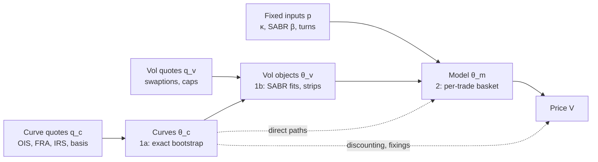
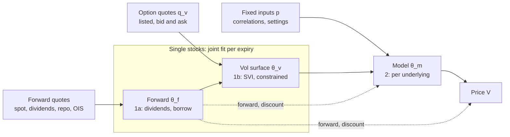
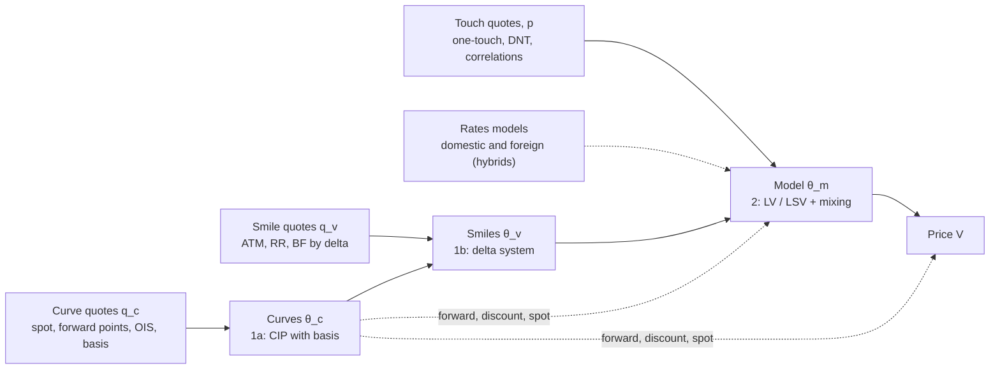

# Calibration Chains: from Quotes to Risk

This page is the mathematical reference for VALAX's **calibration → pricing →
risk** pipeline. Part I states the general framework that every asset class
shares: one calibration level, its implicit-function-theorem derivative, the
chain of levels, the adjoint sweep that turns a price gradient into quote risk,
and the degenerate chains (constant-parameter Black-Scholes, single curve).
Part II maps each piece to the VALAX symbol that implements it. Part III lays
the full chains for rates, equities and FX side by side, with worked examples.

- **How-to** (runnable, three market tiers): [From Quotes to Risk](../guide/calibration-to-risk.md).
- **Design** (contracts, extension recipe, scaling): [Calibration, Pricing & Risk Architecture](../architecture/calibration-pricing-risk.md).
- **Conformance** (requirement-by-requirement status): [Multi-Curve / AAD Audit Conformance](../architecture/aad-audit-conformance.md).

## Part I — The general framework

### I.1 One calibration level

Every calibration — a curve bootstrap, a smile fit, a model fit to a basket —
solves a residual system for its unknowns $\theta_\ell$, given the level's own
quotes $q_\ell$, everything calibrated before it (the upstream market
$\mathcal{M}_{<\ell}$) and held-fixed inputs $p_\ell$ (SABR $\beta$, mean
reversion, convexity adjustments, event weights):

$$
R_\ell\big(\theta_\ell;\; q_\ell,\ \mathcal{M}_{<\ell},\ p_\ell\big) = 0 .
$$

The calibrated object (curve graph, surface, model) is an explicit map of the
unknowns, $X_\ell = A_\ell(\theta_\ell;\, q_\ell, \mathcal{M}_{<\ell}, p_\ell)$
— usually of $\theta_\ell$ alone, but a surface that stores its forwards also
reads the upstream market directly.

**Exactly-determined levels** (curves, quote conversions, optionlet strips, the
FX delta system) are square. If the residual is in quote units and linear in
the quote, $\partial R/\partial q = -I$; in general it is not (a swap residual
in PV units has $\partial R/\partial q = $ annuity), so VALAX always
differentiates $\partial R/\partial q$ rather than assuming it.

**Least-squares levels** (SABR / SVI smiles, Heston, model baskets) minimise

$$
\Phi(\theta) = \tfrac12\, r(\theta, q)^{\top} W\, r(\theta, q)
$$

and enter the chain through their first-order condition, which *is* square:

$$
R(\theta, q) := \nabla_\theta \Phi = J^{\top} W\, r = 0, \qquad
\frac{\partial R}{\partial \theta} = J^{\top} W J + \sum_k (W r)_k\, \nabla^2_{\theta} r_k,
\qquad J = \frac{\partial r}{\partial \theta}.
$$

VALAX keeps the **full** Hessian, not the Gauss-Newton term $J^\top W J$: the
two coincide only on a perfect fit, and the full form keeps the adjoint correct
when the fit is not tight. Stationarity is invariant under a smooth
reparametrisation at an interior optimum, so the solver's unconstrained
coordinates may be used directly.

**Constrained fits** (arbitrage-free SVI) use the KKT system on the active set
(§3.3 below); the theorem applies while the active set is unchanged.

**Explicit levels** have no solve — installing a quoted spot, a flat rate, a
Dupire transform of an upstream surface. They are differentiated by plain
AAD (reverse-mode autodiff). A Monte Carlo fixed point run for a fixed number of passes
(the SLV leverage) is explicit in the same sense; see §I.8.

**Batched levels** — one independent fit per node (smile per expiry, SABR per
cube cell, strip per strike column) — are a single level with a
block-diagonal Jacobian; see §I.9.

### I.2 The implicit function theorem

At a converged solution $\theta^*$ with $\partial R/\partial\theta$
invertible,

$$
\frac{d\theta}{dq} = -\left(\frac{\partial R}{\partial \theta}\right)^{-1}
\frac{\partial R}{\partial q},
$$

and for any scalar $V$ depending on $\theta$ with cotangent
$\bar\theta = \partial V/\partial\theta$,

$$
\left(\frac{\partial R}{\partial \theta}\right)^{\!\top}\lambda = \bar\theta,
\qquad
\bar q = -\left(\frac{\partial R}{\partial q}\right)^{\!\top}\lambda,
\quad
\overline{\mathcal{M}}_{<\ell} \mathrel{+}= -\left(\frac{\partial R}{\partial \mathcal{M}_{<\ell}}\right)^{\!\top}\lambda,
\quad
\bar p = -\left(\frac{\partial R}{\partial p}\right)^{\!\top}\lambda .
$$

The optimiser is never differentiated, $d\theta/dq$ is never formed, and the
three right-hand contractions are **one** vector-Jacobian product of $R$ with
respect to the triple $(q, \mathcal{M}_{<\ell}, p)$. The theorem needs a
solution: on a non-converged level every sensitivity downstream is meaningless,
which is why each level reports its residual and convergence flag, and its
condition number $\kappa(\partial R/\partial\theta)$ (roughly
$\log_{10}\kappa$ of 16 significant digits are lost in the transposed solve).

### I.3 The chain and the price

Levels run in dependency order — curves (1a), vol objects (1b), then the
pricing model (level 2) — and the price reads the calibrated market and model:

$$
V = \mathrm{price}\Big(I,\ M\big(\theta_m\big),\ \mathcal{M}\big(\theta_1,\dots,\theta_L\big)\Big),
\qquad
R_m\big(\theta_m;\ q_m,\ \mathcal{M},\ p_m\big) = 0 .
$$

The market levels are **shared**: built once per snapshot, used by every trade.
The model level is **per basket**: per trade for a rates exotic (Hull-White on
its co-terminal swaptions), per underlying for an equity book (Heston on the
surface). That is why the model is a separate input to the pricer rather than
part of the market.

### I.4 The adjoint sweep

One reverse sweep through the pricer gives the cotangents of the market and of
the model, $\overline{\mathcal{M}}$ and $\bar M$. The levels are then visited in
reverse order. For each level $\ell$:

1. **Pull back** the running cotangent on its calibrated object to its unknowns
   and inputs through the assemble map:
   $\bar\theta_\ell = (\partial A_\ell/\partial\theta_\ell)^\top \bar X_\ell$, plus
   any direct input contribution $(\partial A_\ell/\partial(q,\mathcal{M},p))^\top \bar X_\ell$.
2. **Solve** $(\partial R_\ell/\partial\theta_\ell)^\top\lambda_\ell = \bar\theta_\ell$
   (skipped for an explicit level).
3. **Split** $-(\partial R_\ell/\partial(q,\mathcal{M}_{<\ell},p))^\top\lambda_\ell$
   into quote risk $\bar q_\ell$, an upstream contribution added to
   $\overline{\mathcal{M}}$, and fixed-input risk $\bar p_\ell$.

Model levels go first, then market levels from last to first. The upstream
contributions are how a vol level fitted on curve forwards hands curve risk back
to the curve quotes, and how a model calibrated on the surface hands vega back
to the vol quotes. The output is $(\bar q, \bar p)$: risk in the instruments the
desk actually trades, plus the sensitivities to every held-fixed choice.

### I.5 Two independent derivatives

The same $(\bar q, \bar p)$ can be obtained without inspecting any level:
differentiate $q \mapsto \mathrm{price}(\mathrm{calibrate}(q, p))$ by
AAD end to end (the autodiff path, `quote_risk_autodiff`), letting each solver's built-in implicit adjoint handle the
solves. VALAX exposes **both** and a reconciliation between them. They fail in
different ways — the explicit sweep on a singular or ill-conditioned
$\partial R/\partial\theta$, the autodiff route on a calibrator that is not
traceable — and agree to solver tolerance otherwise, which makes each a
validation of the other. Neither survives a non-converged calibration.

### I.6 Books: one sweep, not one per trade

The sweep is linear in its seed. For a book $V_{\text{book}} = \sum_i n_i V_i$
priced off one market,

$$
\overline{\mathcal{M}}_{\text{book}} = \sum_i n_i\, \overline{\mathcal{M}}_i ,
$$

so the market levels are swept **once** with the summed cotangent. Per-trade
quote risk costs one transposed solve per trade against factorisations that can
be cached per snapshot; model levels are swept per basket.

### I.7 Degenerate chains

The framework contains the simpler worlds as special cases, with no separate
code path:

| Market | Chain | Quote risk equals |
| --- | --- | --- |
| Constant-parameter Black-Scholes | one explicit level installing $S, r, \sigma, q$ | the textbook delta, rho, vega and dividend sensitivity |
| Fully specified model, no quotes | the empty chain | nothing to push back: risk lives on the market / model directly |
| Single curve | one curve level with one block | the single-curve bootstrap adjoint |
| Multi-curve | one joint curve level, block lower-triangular | the multi-curve bootstrap adjoint, including indirect discount delta |
| + smile, + model | further levels | full quote-space delta and vega |

### I.8 Fixed-point levels

Some calibrations are not a residual driven to zero but a fixed-point
iteration $L_{k+1} = G(L_k;\, \mathcal{M}_{<\ell})$ run for a fixed number of
passes $K$. The SLV leverage is the case in point: $G$ runs one
Guyon–Henry-Labordère sweep, building
$L^2 = \sigma^2_{\text{Dupire}} / \widehat{\mathbb E}[V_t \mid k_t = k]$ row by
row from particles simulated under the rows already built ($L_k$ enters only
as the predictor of the not-yet-built row in the midpoint-in-time
interpolation), with fresh Monte Carlo randomness on every pass. Because each
sweep is already self-consistent, the increment $L_K - L_{K-1}$ for
$K \ge 2$ is the estimator's Monte Carlo noise — a stability check, not a
contraction. The output is the composition

$$
L_K = G\big(G(\cdots G(L_0)\cdots)\big), \qquad L_0 \equiv 1 ,
$$

an **explicit** function of the upstream inputs, and VALAX treats it as an
explicit level ($\theta = \varnothing$) differentiated by plain AAD
through the $K$ unrolled passes.

The implicit function theorem is not used, because its hypothesis fails: it
needs a point with $R(\theta^\star) = 0$, and the natural candidate
$R(L) = L - G(L)$ is never zero here — each evaluation of $G$ carries sampling
noise of order $1/\sqrt{N_{\text{paths}}}$, so $\|L_K - G(L_K)\|$ stalls at
the noise floor however many passes are run. Applying
$(\partial R/\partial L)^{-\top}$ at a non-solution would differentiate a
system nobody solved. Differentiating the passes actually computed is exact for
the value actually returned.

Convergence is still measured, on the last increment:

$$
r = L_K - L_{K-1}, \qquad \text{converged} \iff \max |r| \le \varepsilon ,
$$

with $\varepsilon$ set above the Monte Carlo noise floor. A single pass has no
increment to measure — $L_1 - L_0$ is only the distance from the warm start —
so $K = 1$ is always reported not converged and the default is $K = 2$.
Implementation: `calibrate_slv_leverage` (`problem="fixed_point"`,
`fixed_point_diagnostics`); recipe on the
[SLV guide](../guide/slv.md#how-the-fixed-point-is-reported).

### I.9 Batched levels

When a level is a set of independent fits — node $i$ with unknowns
$\theta_i$ and inputs $u_i(q, \mathcal{M}, p)$ — VALAX solves each node
separately (each with its own convergence flag, reported by name) but treats
the nodes as **one** level for the adjoint, with the stacked residual

$$
R(\theta; q, \mathcal{M}, p) =
\begin{pmatrix} R_1(\theta_1;\, u_1) \\ \vdots \\ R_n(\theta_n;\, u_n) \end{pmatrix},
\qquad
\frac{\partial R}{\partial \theta} = \operatorname{diag}\!\left(\frac{\partial R_1}{\partial \theta_1}, \dots, \frac{\partial R_n}{\partial \theta_n}\right).
$$

The transposed solve of §I.4 decouples into $n$ small solves, and the condition
number of the level is the ratio of the extreme singular values over all
blocks. The node inputs $u_i$ are functions of the level inputs, not
constants: a cube cell's forward is recomputed from the upstream curves inside
the level, so $\partial R/\partial \mathcal{M}_{<\ell} \neq 0$ and the cell
hands curve risk back up the chain. A sequential bootstrap (the cap strip,
bucket $i$ reading buckets $< i$) is the lower-triangular analogue: solved
bucket by bucket, packaged as one triangular level.

**Failure semantics.** Each node (and, for a strip, each bucket — a node
carries a sub-node axis, labelled per $(\text{strike}, \text{bucket})$)
reports its own convergence. A failed strip bucket installs NaN, never a
best-effort value (a NaN-fed cube cell likewise ends NaN):
$\theta_i \leftarrow \texttt{where}(c_i, \theta_i, \mathrm{NaN})$ with $c_i$
the convergence flag. The mask is against a
constant, so on a converged node $\partial\theta_i/\partial(\cdot)$ — and
hence the adjoint — is unchanged. In the triangular case the NaN propagates
to every later bucket; this is the honest outcome (their equations read an
undefined input) and the first failure is recorded as the root cause.

**Joint levels** (a curve build: one Newton solve, $\partial R/\partial\theta$
dense) have no per-node flag, so a failure is attributed from the inputs and
residuals: a non-finite quote $q_i$ makes every $R_j$ non-finite and is named
directly; otherwise the nodes with $|R_i| \ge \tfrac12 \max_j |R_j|$ are named,
evaluated at the solver's last iterate — or, when that iterate is non-finite,
at the starting point $\theta_0$, where an infeasible quote's residual
dominates. The latter is a heuristic, not a theorem: it localises a single
gross outlier, not a subtle inconsistency spread over several quotes.

**Trade data.** A level's residual may read instrument data that is neither a
quote, an upstream object nor a held-fixed input (a per-trade basket). It is a
fourth input block, $d$, carried as a pytree leaf
(`LevelInputs.data`) so the level is a function of its arguments only — a
result returned from `jit` / `vmap` holds no captured tracer. $\bar d$ is
computed by the VJP but never accumulated: $d$ is a contract term, not a risk
factor.

### I.10 Per-trade model levels and the vega profile

For a rates exotic the model level is per trade: model $M(\theta_m)$ fitted to
basket instruments $I_k$ (e.g. the co-terminal Europeans of a Bermudan) whose
targets are read off the calibrated market,

$$
r_k(\theta_m) = w_k\,\frac{\mathrm{price}\big(I_k, M(\theta_m), \mathcal{M}\big) - \big(T_k(\mathcal{M}) + s_k\big)}{|T_k(\mathcal{M}) + s_k|},
\qquad T_k = \mathrm{price}\big(I_k \mid \text{cube}, \text{curves}\big),
$$

entering the chain through its first-order condition $R_m$ as in §I.1. The
level reads only the market (and its fixed inputs), so the sweep of §I.4 hands
$\lambda_m$ through $\partial R_m/\partial \mathcal{M}$ into the cube and curve
levels: the trade's vega and the curve paths of its calibration reach the
quotes in one pass.

The **target shifts** $s_k$ are held-fixed inputs at value $0$. Because they
enter the residual only through $T_k + s_k$, $\partial R_m/\partial s_k =
\partial R_m/\partial T_k$, and

$$
\frac{\partial V}{\partial T_k} = -\left(\frac{\partial R_m}{\partial T_k}\right)^{\!\top}\lambda_m
= -\left(\frac{\partial R_m}{\partial s_k}\right)^{\!\top}\lambda_m = \bar s_k ,
$$

so the fixed-input sensitivities of the shifts *are* the trade's exposure to
each basket instrument's price — its vega profile across the basket — read off
the same sweep with no extra solve, and checkable by bumping $s_k$ and
recalibrating. Converting $\partial V/\partial T_k$ to vol units by each basket
option's own vega gives the profile per vol point; shifting every cube quote by
the same amount moves each basket vol by that amount, so the total cube vega
equals the summed basket profile (§7.7 states the same identity for a
vega-scaled residual, where $\lambda_{m,k}$ itself is the vega).

**The co-terminal bootstrap.** With $n$ basket instruments and fewer than $n$
constant parameters the level is a least-squares compromise. Giving the model
a piecewise-constant volatility with one bucket per co-terminal, with
breakpoints at the expiries ([Time-Dependent
Volatility](time-dependent-volatility.md)), makes it **square and
lower-triangular**: co-terminal $k$ expires at $T_k$ and so reads only
$\sigma_1, \dots, \sigma_k$,

$$
\frac{\partial r_k}{\partial \sigma_j} = 0 \quad (j > k), \qquad
r_k(\sigma_1, \dots, \sigma_k) = 0 \quad (k = 1, \dots, n),
$$

a `root` level with exact repricing. It is solved bucket by bucket: $\sigma_k$
is one scalar Newton root with $\sigma_{1..k-1}$ already known, and the
earlier roots are passed as solver arguments so autodiff differentiates
through every stage. The adjoint is still the single transposed solve of §I.4
(upper-triangular, by back-substitution), and $\lambda_m$ now has exactly one
entry per exercise date, the trade's exposure to the co-terminal of that
date. A target that the earlier buckets already overprice has no root; the
triangular structure names that bucket as the cause of the failure and leaves
the buckets before it exact. Why it is solved bucket by bucket rather than
jointly is recorded in the architecture (D14,
[decisions](../architecture/calibration-pricing-risk.md#3-decisions)); its
assumptions and measured limitations are in the
[register](../applications/calibration-register.md#per-trade-co-terminal-bootstrap).

## Part II — How VALAX implements the chain

<!-- coverage-map -->

| Piece | VALAX symbol | Status |
| --- | --- | --- |
| Level $R(\theta; q, \mathcal{M}, p)$ | `valax.calibration.level.CalibrationLevel`, `LevelInputs` | ✅ |
| One IFT step | `valax.calibration.level.level_adjoint` | ✅ |
| Solve + diagnostics (traceable `converged`) | `valax.calibration.solve.solve_level`, `CalibrationResult`, `SolverSettings` | ✅ |
| Batched level, block-diagonal (§I.9), failures named per node (per `(node, sub-node)` with `sub_labels`; root cause of a sequential strip) | `valax.calibration.solve.solve_batched_level`, `CalibrationResult.failed_labels`, `CalibrationResult.root_cause_labels` | ✅ |
| Joint-level failure localisation (§I.9) | `CalibrationResult.failed_labels` (non-finite quote → worst cluster, `FAILURE_CLUSTER_FRACTION`) | ✅ |
| Trade-data input block (§I.9) | `LevelInputs.data` (`swaption_basket_node`, `price_fit_node`, `basket_fit_level(data=...)`) | ✅ |
| Explicit level | `valax.calibration.solve.explicit_level`, `market_inputs_node` | ✅ |
| Fixed-point level (§I.8) | `calibrate_slv_leverage` (`problem="fixed_point"`, `fixed_point_diagnostics`) | ✅ standalone; not a chain node |
| 1a curves (single / multi, basis, xccy) | `valax.calibration.nodes.curve_graph_node` (same level as `bootstrap_curve_graph`) | ✅ |
| 1b SABR smiles on upstream forwards (equity, lognormal) | `valax.calibration.nodes.sabr_smile_node` | ✅ |
| 1b quote conversion / any market fit through `price` | `price_fit_node(..., install_fn=...)` | ✅ |
| 1b swaption cube on upstream forwards | `swaption_cube_node` (shares `swaption_cube_level` with `calibrate_swaption_cube_from_curves`) | ✅ |
| 1b optionlet strip → optionlet SABR | `caplet_strip_node` → `optionlet_sabr_node` | ✅ |
| 1b constrained SVI (KKT), FX delta system | — | ❌ |
| 1a equity forward with discrete dividends / repo | — (continuous dividend quote only) | ❌ |
| 2 model fit through `price` (per underlying) | `price_fit_node` + `calibrate_model` (Heston tested) | ✅ |
| 2 per-trade basket (§I.10) | `coterminal_swaptions` + `swaption_basket_node` (Hull-White and G2++ validated multi-curve, Cheyette single-curve) | ✅ |
| 2 Dupire (explicit) | — | ❌ |
| Adjoint sweep | `valax.greeks.quote_risk.chain_adjoint`, `quote_risk_adjoint` | ✅ |
| Autodiff path + reconciliation | `quote_risk_autodiff`, `reconcile_quote_risk` | ✅ |
| Book sweep | `chain_adjoint` on a summed market cotangent | ✅ |

## Part III — Chains by asset class: rates, equities and FX

"Audit" below refers to the *Multi-Curve Calibration and AAD Risk: Audit
Specification*, whose requirement-by-requirement status is tracked in the
[conformance map](../architecture/aad-audit-conformance.md); "Architecture" to
the companion pricing-architecture note. Requirement prefixes: RT (rates), EQ
(equities), FX (FX), XA (cross-asset).

## 0. Purpose and scope of Part III

This document lays the calibration chain of the Audit Specification (its Section 7.3) side by side for rates, equities and FX, so that one AAD and implicit-differentiation framework can serve all three and each can be audited against its own residuals.

- **Companion documents.** "Multi-Curve Calibration and AAD Risk: Audit Specification" (Audit), "Pricing Architecture, Risk Caching and Key Ontology" (Architecture) and "Neural Surrogates in the Pricing Stack". Rates details here summarise the Audit; equities and FX are specified here.
- **Each asset section has the same four parts:** the full chain diagram; the risk factors, separated into those shared with other asset classes and those specific to this one; the construction of the residuals at each calibration level; and what changes in the adjoint pass.
- **Requirement prefixes:** RT (rates), EQ (equities), FX (FX), XA (cross-asset). MUST and SHOULD as in the companion documents.
- **Notation** follows Part I (and Audit Section 1): theta for unknowns, q for quotes, p for fixed inputs, R for residuals, bars for adjoints.

## 1. Common skeleton and comparison

All three asset classes run the same chain: quotes, then curves or forwards, then a volatility object, then a model, then the price. Each calibration level is an equation R(theta; inputs) = 0 differentiated by the implicit function theorem; what differs is the objects at each level, whether the model is calibrated per trade or per underlying, and a few asset-specific difficulties.

### 1.1 The skeleton

| Level | Generic unknowns | Generic residual |
| --- | --- | --- |
| 1a. Curves and forwards | theta\_c: curve, dividend, borrow or basis nodes | Model par rate, forward or spread minus quote |
| 1b. Volatility object | theta\_v: smile or surface parameters | Model vol or price at each quoted point minus quote; may be least squares, constrained, or implicit in strike |
| 2. Model | theta\_m: model parameters | Model price of calibration instruments minus target |
| Pricing | none | V(theta\_m, theta\_c, p) |

The adjoint pass is identical in form for all three (Audit 7.3): one reverse sweep through the pricer, then at each level a transposed solve for lambda and one vector-Jacobian product of R seeded with lambda, from level 2 back to level 1a. Delta and vega to quotes come out of the last two levels. Where a level is an explicit formula rather than a solve (Dupire local vol), it is differentiated by plain AAD with no linear solve.

### 1.2 Side by side

|  | Rates | Equities | FX |
| --- | --- | --- | --- |
| Level 1a | OIS discount and projection curves | Forward curve: spot, dividends, borrow; discount from rates | Both OIS curves plus collateral-adjusted foreign curve; spot |
| Level 1b | Swaption cube (expiry, tenor, strike); optionlet surface | Implied vol surface (expiry, strike) per underlying | Smile per tenor quoted in delta (ATM, RR, BF) |
| Vol quote form | Normal vol or premium at ATM offsets | Listed option prices, bid and ask; American for single stocks | ATM, risk reversal, butterfly at fixed deltas |
| Level 2 scope | Per trade, local basket | Per underlying, whole surface | Per currency pair, whole smile set; optional touch level |
| Typical models | Hull-White, Cheyette | Local vol, Heston, local-stochastic vol | Local vol, local-stochastic vol, rates-FX hybrids |
| Pricing | PDE for Bermudans; Monte Carlo for path-dependent | Monte Carlo with payoff smoothing; PDE in low dimension | PDE for barriers and touches; Monte Carlo for TARFs and hybrids |
| Smile dynamics when vol quotes are held fixed | Sticky moneyness (offset quotes) | Depends on quote form; usually sticky strike for listed | Sticky delta |
| Specific difficulty | Multi-curve basis, per-trade calibration | Discrete dividends, constrained fit, American quotes | Delta-strike-vol system, spot date and calendars, touch level |

## 2. Rates

Rates is the reference case: a multi-curve system at level 1a, a SABR swaption cube and optionlet surface at level 1b, and a model calibrated per trade to a local basket at level 2. The full specification is in the Audit; this section summarises it in the common format.

### 2.1 Full chain

Quotes enter at the curves and the cube; the model is calibrated per trade; the curves also reach the model and the price directly (Audit 6.4).

### 2.2 Risk factors

| Group | Example keys (Architecture 5.4) | Enters at | Shared or specific |
| --- | --- | --- | --- |
| OIS quotes | `Q.EUR..OIS.ESTR.ON..10Y.....PAR` | 1a | Shared: discount curve for equities and FX |
| Projection and basis quotes (FRA, IRS, tenor basis) | `Q.EUR..IRS.EURIBOR.6M..10Y.....PAR` | 1a | Specific: multi-curve basis |
| Cross-currency basis | `Q.EUR;USD..XCCY.ESTR;SOFR.ON;ON..10Y.....SPREAD` | 1a | Shared with FX |
| Swaption vols (ATM and offsets) | `Q.EUR..SWPTN.EURIBOR.6M.1Y.10Y.ATM....NVOL` | 1b | Specific |
| Cap vols | `Q.EUR..CAP.EURIBOR.6M..5Y.ABS.250...NVOL` | 1b | Specific |
| Mean reversion | `P.EUR..MEANREV.EURIBOR.6M.......KAPPA` | 2 | Specific; also used by FX hybrids |
| SABR beta and shifts, turns, futures convexity | `P.EUR..SABR.EURIBOR.6M.1Y.10Y.....BETA` | 1a, 1b | Specific |

### 2.3 Residual construction

| Level | Unknowns | Residual | Fit | Audit |
| --- | --- | --- | --- | --- |
| 1a | Curve nodes per curve, block lower-triangular | Model par rate or spread minus quote | Exact, square | 4.2, 4.3 |
| 1b quote conversion | Implied normal vol per premium quote | Bachelier price with A\_d and S\_x minus premium | Exact, scalar | 5.2 |
| 1b optionlets | Optionlet vols per expiry and strike | Sum of caplets at optionlet vols minus sum at flat vol | Exact, triangular | 5.3 |
| 1b cube | SABR (alpha, rho, nu) per expiry and tenor | SABR vol at quoted strike minus quote | Least squares per node | 5.4 |
| 2 | sigma(t) pieces, skew parameters | Model price of basket minus cube target, vega-scaled | Exact (bootstrap) or least squares | 6.3 |

The two residuals that carry most of the multi-curve structure:

$$
R_{c,k} = \frac{\sum_i \tau^x_i P_d(0,T_i^p) F_x(0;T_i)}{\sum_j \tau^{\mathrm{fix}}_j P_d(0,T_j^p)} - q_k, \qquad R_{m,k} = \frac{V^{\mathrm{mod}}_k(\theta_m;\theta_c,p) - A_{d,k}\,\mathrm{Bach}\big(S_{x,k}, K_k, \sigma_{\mathrm{cube}}(K_k), T_k\big)}{\mathcal{V}_k}
$$

### 2.4 Adjoint specifics

- Level 2 is per trade: steps 1 and 2 of Audit 7.3 run per calibration group; levels 1a and 1b run once per snapshot through G.
- The curves receive adjoints from six paths in level 2 and pricing (Audit 6.4); missing any one gives a wrong delta.
- The curve solve is block-triangular, so the transposed solve runs projection and basis blocks first and the discount block last.

**In VALAX.** The rates chain runs end to end as chain levels: `curve_graph_node` (1a) → `swaption_cube_node`, a batched level (§I.9) whose cell forwards and annuities are recomputed from the upstream curves, and `caplet_strip_node` → `optionlet_sabr_node` (1b; the optionlet level has no quotes of its own, so its adjoint flows entirely upstream to the cap quotes and curves) → `swaption_basket_node` per trade (2; §I.10), with the Bermudan priced through `price(..., method="pde")`. `chain_adjoint` with `model_levels` runs the per-trade steps of the sweep and then the shared market levels. Status per requirement: [conformance map](../architecture/aad-audit-conformance.md); how-to: [From Quotes to Risk](../guide/calibration-to-risk.md#rates-per-trade-model-calibration).

**Requirements**

- **RT-1 (MUST)** Rates implementations meet the Audit Specification in full; this section adds no requirement beyond it.
- **RT-2 (MUST)** The rates OIS and cross-currency curves used by equities and FX are the same objects, from the same snapshot, as those of the rates stack (XA-1).

## 3. Equities

In equities, a forward curve built from spot, dividends and borrow replaces the projection curves; the vol object is a constrained implied-vol surface per underlying; and the model is calibrated once per underlying, not per trade. For single stocks, American quotes force the forward and the vols to be fitted together.

### 3.1 Full chain

The discount curve comes from the rates stack. For single stocks, levels 1a and 1b merge into one fit per expiry.

### 3.2 Risk factors

| Group | Example keys | Enters at | Shared or specific |
| --- | --- | --- | --- |
| Spot | `Q.EUR..SPOT.SX5E........PRICE` | 1a | Specific |
| Dividend futures and swaps | `Q.EUR..DIVFUT.SX5E......2027-12-17..PRICE` | 1a | Specific |
| Repo or borrow | REPO quotes, by tenor | 1a | Specific |
| OIS discount curve | Rates keys (Section 2.2) | 1a | Shared with rates |
| Listed option quotes | `Q.EUR..EQOPT.SX5E....PCTS.9000.2026-12-18..PRICE` | 1b | Specific |
| Correlations between underlyings | `P.EUR;USD..CORR.SX5E;SPX........RHO` | 2 | Specific (multi-asset) |
| FX vol and equity-FX correlation | FX keys (Section 4.2) | 2 | Shared with FX (quantos) |
| Fit settings: SVI weights, dividend model (cash or proportional) | P keys | 1a, 1b | Specific |

Ontology extensions: TYPEs SPOT, DIVFUT, REPO, EQOPT, SVI and CORR; STRIKE\_TYPE values PCTS and PCTF (percent of spot or forward, stored in bp, so 90% is 9000); listed expiries are fixed dates in DATE and are mapped to tenor buckets for reporting (Architecture 4.2).

### 3.3 Residual construction

The forward, with q the borrow fee or repo spread, r\_s = r - q the stock's net carry rate, and D\_i the cash dividend paid at t\_i:

$$
F(T) = \Big(S_0 - \sum_{t_i \le T} D_i\, e^{-\int_0^{t_i} r_s(u)\,du}\Big)\, e^{\int_0^T r_s(u)\,du}
$$

| Level | Unknowns | Residual | Fit |
| --- | --- | --- | --- |
| 1a, index (European options) | Dividend and borrow nodes theta\_f | Parity-implied forward minus model forward, over strikes near ATM per expiry | Least squares per expiry |
| 1a, dividend futures | Dividend nodes | Model expected dividends over the contract period minus futures price | Exact |
| 1a + 1b, single stock (American options) | Per expiry: forward (via borrow) and smile parameters | American model price (PDE or tree with discrete dividends) minus mid quote, vega-weighted | Least squares per expiry, joint |
| 1b, surface | SVI per expiry, or SSVI across expiries | Implied total variance at each quote minus model total variance, weighted by bid-ask | Least squares with no-arbitrage inequality constraints |
| 2, local vol | none | Explicit Dupire formula from the surface | No solve |
| 2, Heston | 5 parameters | Model vol (Fourier pricing) minus surface vol on a grid | Least squares |
| 2, local-stochastic vol | Leverage function nodes, SV parameters | Model vanilla prices minus surface | Fixed point; least squares on a PDE |

**European parity residual** for strike K\_j at expiry T:

$$
r_j = \big[C(K_j,T) - P(K_j,T)\big]_{\mathrm{mkt}} - P_d(0,T)\,\big(F(T;\theta_f) - K_j\big)
$$

For American options parity holds only as a pair of bounds, which is why single stocks use the joint fit instead.

**SVI** total variance per expiry, with log-moneyness k = ln(K / F(T)) and w = sigma\_imp^2 T:

$$
w(k) = a + b\Big(\rho\,(k-m) + \sqrt{(k-m)^2 + s^2}\Big)
$$

**Constrained fit.** Minimising Phi(theta) subject to no-arbitrage constraints c(theta) >= 0 (non-negative density in k, total variance non-decreasing in T), the calibration equation is the KKT system on the active set A, with multipliers mu:

$$
R(\theta,\mu_A;q) = \begin{pmatrix} \nabla_\theta\Phi(\theta;q) - \nabla_\theta c_A(\theta)^{\top}\mu_A \\ c_A(\theta) \end{pmatrix} = 0
$$

The IFT applies to (theta, mu\_A) while the active set is unchanged and each active multiplier is strictly positive.

**Dupire** local variance from total implied variance w(k, T) (Gatheral's form):

$$
\sigma_{\mathrm{loc}}^2(K,T) = \frac{\partial_T w}{1 - \frac{k}{w}\partial_k w + \frac14\left(-\frac14 - \frac1w + \frac{k^2}{w^2}\right)(\partial_k w)^2 + \frac12\,\partial_{kk} w}
$$

### 3.4 Adjoint specifics

- **Level 2 per underlying.** The model calibration is part of the snapshot build, cached and shared by every trade on the underlying. G is extended to the model parameters of each underlying; the per-trade work is pricing and one adjoint sweep.
- **Dupire needs no solve.** AAD runs straight through the formula, which uses second derivatives of the surface, so the surface must be smooth enough for those derivatives to be stable.
- **Constrained surface.** Sensitivities come from the KKT system above and can jump when a constraint becomes active or inactive. Active-set changes between snapshots are monitored.
- **Single stocks.** The joint forward-and-vol block per expiry has an American pricer inside its residual; its adjoint is the discrete adjoint of that PDE or tree.
- **Rates delta.** The discount curve is the rates curve, so equity trades receive adjoints on rates OIS quotes.
- **Local-stochastic vol.** A leverage function fitted by Monte Carlo fixed point is a noisy solve; define the residual on a PDE so the IFT applies, or report its sensitivities by bumping. (VALAX takes a third route for its particle calibration: the fixed point is an explicit level differentiated by AAD through the unrolled passes, with convergence measured on the last increment — §I.8.)
- **Pricing.** Monte Carlo with smoothed triggers and barriers (autocallables, barriers, digital coupons); regression with frozen coefficients for products with a real exercise decision; PDE in one or two dimensions where possible.

**Requirements**

- **EQ-1 (MUST)** The forward follows 3.3: dividends discounted at r\_s; the repo convention (borrow fee with minus sign, or full financing rate with plus sign) is documented and applied consistently.
- **EQ-2 (MUST)** For American-quoted underlyings, forward and vols are fitted jointly per expiry; put-call parity is never used as an equality.
- **EQ-3 (MUST)** Constrained fits record the active set per snapshot; sensitivities use the KKT system on that set; active-set changes are flagged.
- **EQ-4 (MUST)** Surfaces feeding Dupire are smooth in k (two derivatives) and T (one derivative); local variance positivity is checked.
- **EQ-5 (MUST)** Level 2 is calibrated once per underlying per snapshot and shared by all trades on it.
- **EQ-6 (MUST)** Monte Carlo engines smooth triggers and barriers; regression coefficients are frozen in the adjoint; the gap between lower and upper (duality) bounds is reported.
- **EQ-7 (MUST)** Correlations and quanto inputs are fixed inputs p with their sensitivities reported.

## 4. FX

In FX, level 1a is the rates curve system extended across two currencies; the vol object is a smile per tenor quoted in delta, whose conversion is an implicit system of its own; and liquid one-touch quotes can add a calibration level for local-stochastic vol models.

### 4.1 Full chain

Both currencies' rates curves and FX spot feed the curve level; hybrids add rate models for each currency feeding the FX model.

### 4.2 Risk factors

| Group | Example keys | Enters at | Shared or specific |
| --- | --- | --- | --- |
| FX spot | `Q.EUR;USD..FXSPOT.........RATE` | 1a | Specific |
| Forward points | `Q.EUR;USD..FXFWD....3M.....POINTS` | 1a | Specific |
| Both OIS curves, cross-currency basis | Rates keys (Section 2.2) | 1a | Shared with rates |
| ATM vols | `Q.EUR;USD..FXOPT...1Y..ATM....ATM_VOL` | 1b | Specific |
| Risk reversals, butterflies | `Q.EUR;USD..FXOPT...1Y..DELTA.25...RR` | 1b | Specific |
| One-touch, double-no-touch | `Q.EUR;USD..ONETOUCH...6M..DELTA.10...PRICE` | 2 (touch level) | Specific |
| Event weights for time interpolation | P keys with DATE | 1b | Specific |
| Mixing fraction (if not calibrated), FX-rates correlations | P keys | 2 | Specific; correlations shared with hybrids |

Ontology extensions: TYPEs FXOPT, ONETOUCH, DNT; STRIKE\_TYPE value DELTA with STRIKE holding the delta; QUANTITY values ATM\_VOL, RR, BF; tenor labels ON, TN and SPOT counted from the spot date. Delta conventions are per pair and live in reference data, not in the key.

### 4.3 Residual construction

**Forward from covered interest parity with basis**, measured from the spot date t\_s, with both discount curves under the trade's collateral:

$$
F(T) = S_{\mathrm{spot}}\,\frac{P^{(c)}_f(t_s,T)}{P^{(c)}_d(t_s,T)}, \qquad R_k = F(T_k;\theta_c) - \big(S + \mathrm{pts}_k \cdot \mathrm{pip}\big)
$$

The pip is 10^-4 for most pairs and 10^-2 for JPY pairs. The unknowns are the nodes of the collateral-adjusted foreign curve; the long end comes from cross-currency basis swaps (Audit 2.4).

| Level | Unknowns | Residual | Fit |
| --- | --- | --- | --- |
| 1a | Collateral-adjusted foreign curve nodes | Model forward minus spot plus points | Exact, inside the rates curve system |
| 1b, per tenor | Smile parameters and the strikes of the quoted deltas | Delta, ATM, risk-reversal and market-strangle equations below | Exact, square, implicit in strike |
| 1b, across tenors | none | Variance interpolation with event weights p | No solve |
| 2, local vol | none | Explicit Dupire formula | No solve |
| 2, local-stochastic vol | Leverage nodes, SV parameters | Model vanilla prices minus smile | Fixed point; least squares on a PDE |
| 2, touch level | Mixing parameter | PDE price of each one-touch or double-no-touch minus quote | Least squares |
| 2, hybrids | Rate models per currency (rates level 2), FX model | Each calibrated to its own instruments | As in rates and above |

**Delta system per tenor.** Delta\_C and Delta\_P are the call and put deltas in the pair's convention (spot or forward, premium-adjusted or not), and sigma(K) is the smile with parameters theta\_v. For the 25-delta pillars:

$$
\begin{aligned}
&\text{ATM (delta-neutral straddle):} && \Delta_C(K_A,\sigma(K_A)) + \Delta_P(K_A,\sigma(K_A)) = 0, \quad \sigma(K_A) = q_{\mathrm{ATM}} \\
&\text{Risk reversal:} && \Delta_C(K_C,\sigma(K_C)) = 0.25, \quad \Delta_P(K_P,\sigma(K_P)) = -0.25, \quad \sigma(K_C) - \sigma(K_P) = q_{\mathrm{RR}} \\
&\text{Market strangle:} && \sigma_S = q_{\mathrm{ATM}} + q_{\mathrm{BF}}, \quad \Delta_C(K^S_C,\sigma_S) = 0.25, \quad \Delta_P(K^S_P,\sigma_S) = -0.25 \\
& && C(K^S_C;\sigma(K^S_C)) + P(K^S_P;\sigma(K^S_P)) = C(K^S_C;\sigma_S) + P(K^S_P;\sigma_S)
\end{aligned}
$$

With a three-parameter smile there are eight equations and eight unknowns (three smile parameters, five strikes). Adding 10-delta pillars adds two smile parameters and the matching equations. Prices C and P are Garman-Kohlhagen with the forward and discount factors of 4.3.

**Touch level:**

$$
R_k = V^{\mathrm{PDE}}_{\mathrm{touch},k}\big(\theta_{\mathrm{mix}};\,\theta_c,\theta_v\big) - q_k
$$

### 4.4 Adjoint specifics

- **Level 1a is part of the rates solve.** The foreign-collateral block depends on both OIS blocks and on spot, so FX trades receive deltas on both currencies' rates quotes, the basis quotes, spot and the forward points from one transposed solve.
- **Strikes are internal unknowns.** In the delta system the strikes sit inside theta\_v for the solve; their adjoints are part of lambda\_v and are never reported. dR\_v/dtheta\_c is non-zero through forwards, discount factors and spot in every delta.
- **Sticky delta by construction.** Holding the delta-quoted q\_v fixed makes the smile move with spot; the desk's delta policy must match.
- **Touch level** adds one implicit step between the smile and the model, or folds the mixing parameter into theta\_m.
- **Hybrids form a graph.** The two currencies' rate-model calibrations feed the FX hybrid; adjoints flow back along both branches and add up at the shared curves.
- **Reporting.** dV/dS is converted to the pair's delta convention (foreign notional, premium-adjusted, reporting currency) by a documented linear map after the chain.
- **Pricing.** PDE with the barrier as a boundary for continuously monitored barriers and touches; Monte Carlo with smoothed target triggers for TARFs and with a Brownian-bridge crossing correction for barriers; regression with frozen coefficients for callable hybrids.

**Requirements**

- **FX-1 (MUST)** Forwards and discount factors run from the spot date, using the combined settlement calendars of both currencies and USD; pip size is per pair.
- **FX-2 (MUST)** The collateral-adjusted foreign curve is the same object as the cross-currency curve of the rates stack (XA-1).
- **FX-3 (MUST)** Delta conventions per pair (spot or forward, premium-adjusted or not, ATM definition) are in reference data and used identically in quote conversion and in risk reporting.
- **FX-4 (MUST)** Each tenor's smile is solved as one square system including strikes; the market strangle is a price condition, never treated as a vol.
- **FX-5 (MUST)** Event weights are fixed inputs p, versioned, with sensitivities reported.
- **FX-6 (MUST)** If touches calibrate the mixing parameter, their residuals use PDE prices and go through an implicit step; otherwise the mixing parameter is in p.
- **FX-7 (MUST)** For hybrids, adjoints from both rates branches are accumulated, and correlation sensitivities reported.
- **FX-8 (MUST)** Reported deltas follow the pair's convention through a documented linear map; the reporting currency is stored with every risk row.

## 5. Cross-asset dependencies

The three chains share objects: the rates curves feed both other asset classes, FX feeds quanto equity products, and rate models feed FX hybrids. One snapshot builds each shared object once, and G carries the cross-asset blocks so that every trade's risk reaches the quotes of every asset class it depends on.

### 5.1 Shared objects

| Consumer | Uses | Produced by | Effect on risk |
| --- | --- | --- | --- |
| Equity forward | OIS discount curve of the collateral currency | Rates 1a | Equity trades have rates delta |
| FX curves | Both OIS curves, cross-currency basis | Rates 1a (same solve) | FX trades have rates delta in both currencies |
| Equity under foreign collateral | Collateral-adjusted discount curve | Rates and FX 1a | Basis delta |
| Quanto equity products | FX vol, equity-FX correlation | FX 1b, p | FX vega and correlation risk |
| FX hybrids (e.g. PRDCs) | Rate models per currency | Rates level 2 | Swaption vega in both currencies |
| Multi-currency equity baskets | Correlations, FX spot and forwards | p, FX 1a | FX delta and correlation risk |

### 5.2 Block structure of G

With quote groups in the order rates (R), FX curve (Xc), equity forward (Ef), equity vol (Ev), FX smile (Xv), the snapshot Jacobian G of Architecture 4.2 has this block pattern:

$$
\frac{d\,(\theta_R,\ \theta_{Xc},\ \theta_{Ef},\ \theta_{Ev},\ \theta_{Xv})}{d\,(q_R,\ q_{Xc},\ q_{Ef},\ q_{Ev},\ q_{Xv})} = \begin{pmatrix} G_{R,R} & 0 & 0 & 0 & 0 \\ G_{Xc,R} & G_{Xc,Xc} & 0 & 0 & 0 \\ G_{Ef,R} & 0 & G_{Ef,Ef} & 0 & 0 \\ G_{Ev,R} & 0 & G_{Ev,Ef} & G_{Ev,Ev} & 0 \\ G_{Xv,R} & G_{Xv,Xc} & 0 & 0 & G_{Xv,Xv} \end{pmatrix}
$$

- The first column is the rates curves reaching every other object: it is never zero.
- G\_{Ev,Ef}: equity vols depend on the forward (log-moneyness, and the joint fit for single stocks).
- G\_{Xv,Xc}: FX smiles depend on forwards, discount factors and spot through the deltas.
- Where level 2 is per underlying or per pair (equities, FX), its parameters can be appended as further rows; rates level 2 stays per trade.

**Requirements**

- **XA-1 (MUST)** Each shared object (rates curves, collateral-adjusted curves, FX smiles used by quantos) is built once per snapshot and used by every asset class from that one instance.
- **XA-2 (MUST)** G contains the cross-asset blocks of 5.2; a trade's quote risk includes every asset class its value depends on.
- **XA-3 (MUST)** The market dependency graph includes cross-asset edges, so a rates quote change invalidates and rebuilds the FX curves, equity forwards and everything downstream.
- **XA-4 (MUST)** The trade's collateral currency selects its discount curve in the same way in all three asset classes.
- **XA-5 (MUST)** Ontology keys are unique across asset classes: TYPE and INDEX values never collide (Architecture 5.3).

## 6. Audit points by asset class

The Audit and Architecture tests apply to every asset class; these are the additional checks each one needs, with the defect each is designed to catch.

| Asset | Check | Pass criterion | Typical defect caught |
| --- | --- | --- | --- |
| Rates | Audit tests T-1 to T-15 | As specified there | Multi-curve and recalibration-path errors |
| Equities | Forward vs independent calculation for a stock with several cash dividends and a non-zero borrow fee | Equal to rounding error | Dividends discounted at OIS instead of r\_s; repo sign convention reversed (EQ-1) |
| Equities | American single-stock quotes: compare joint fit with a sequential parity-then-vol fit | Joint fit reprices calls and puts; sequential fit visibly does not | Parity used as an equality (EQ-2) |
| Equities | Bump a quote that switches a no-arbitrage constraint between active and inactive | Sensitivity jump flagged; KKT-based sensitivities match finite differences on each side | Constraints ignored in the IFT (EQ-3) |
| Equities | Local variance across the surface after each fit | Positive and finite everywhere | Non-smooth or arbitrageable surface feeding Dupire (EQ-4) |
| Equities | Autocallable delta and gamma near a trigger, AAD vs finite differences | Agreement within tolerance; no spikes | Unsmoothed triggers (EQ-6) |
| FX | Spot dates and forwards for pairs with different settlement lags and holidays | Match reference calendars exactly | Wrong spot lag or calendar (FX-1) |
| FX | Rebuild each tenor's smile and recompute the quoted deltas from it | Deltas, ATM, RR and the market strangle price condition all hold | Market strangle treated as a vol; wrong delta convention (FX-3, FX-4) |
| FX | Delta reported for a premium-adjusted pair vs an independent calculation | Equal | Reporting map missing (FX-8) |
| FX | Hybrid trade: sum of domestic and foreign rates risk vs full rebuild bumping both currencies | Equal within tolerance | One rates branch dropped in the adjoint (FX-7) |
| Cross-asset | Bump one rates OIS quote; check that FX curves, equity forwards and dependent trades all move | All dependents rebuilt; their risk includes the quote | Missing cross-asset edge or G block (XA-2, XA-3) |

## 7. Worked examples: residuals, derivatives and adjoints

For each instrument, this section gives the residual (for calibration instruments) or the price (for traded products), the partial derivatives the implicit function theorem needs, and how adjoints flow through it. Read together, the examples cover the full path from quotes through calibration and pricing to risk.

Conventions for every example:

- A **Jacobian row** is the derivative of one residual with respect to the unknowns; the calibration solve and the transposed solve (dR/dtheta)^T lambda = theta-bar use these rows.
- A **VJP** (vector-Jacobian product) pushes a seed vector v back through the residual: (dR/d inputs)^T v. AAD computes it in one reverse sweep; the formulas show what that sweep evaluates.
- **Quote sensitivity** is q-bar = -(dR/dq)^T lambda. It equals lambda only when the residual is in quote units and linear in the quote (Audit A-12); several examples below show cases where it is not.

| Example | Role | Level | Residual units | dR/dq | Point illustrated |
| --- | --- | --- | --- | --- | --- |
| 7.1 OIS swap | Calibration | 1a | Rate | -1 | Explicit Jacobian of a curve residual |
| 7.2 IRS vs EURIBOR | Calibration | 1a | Rate | -1 | Two curves in one residual |
| 7.3 Interest rate future | Calibration | 1a | Rate | +1/100 | Fixed-input sensitivity (convexity) |
| 7.4 Cross-currency basis swap | Calibration | 1a | PV or spread | -A or -1 | Residual units change dR/dq |
| 7.5 Swaption | Calibration | 1b | Price or vol | -1 | Quote conversion; SABR VJP |
| 7.6 Cap | Calibration | 1b | Price | -(flat vega) | Quote enters on the target side |
| 7.7 Bermudan swaption | Trade | 2 and pricing | Vega-scaled price | via cube | lambda\_m equals vega to basket vols |
| 7.8 Equity autocallable | Trade | Pricing | none | none | Monte Carlo AAD with smoothing, through Dupire |
| 7.9 FX vanilla option | Trade and 1b | 1b and pricing | Mixed | Structured | Vega to ATM, RR and BF |
| 7.10 FX one-touch | Calibration and trade | 2 (touch level) | Price | -1 | Least-squares touch calibration |

### 7.1 OIS swap (curve calibration)

With pillars on payment dates and no payment lag, write P\_j = P\_d(0,T\_j) and A = sum\_j tau\_j P\_j:

$$
R = S - q, \qquad S = \frac{P_0 - P_n}{A}
$$

**Jacobian row**, with respect to the discount factors:

$$
\frac{\partial S}{\partial P_0} = \frac{1}{A}, \qquad \frac{\partial S}{\partial P_j} = -\frac{S\,\tau_j}{A}\ \ (0<j<n), \qquad \frac{\partial S}{\partial P_n} = -\frac{1 + S\,\tau_n}{A}
$$

The curve nodes enter through P\_j = exp(-Z(T\_j; theta\_d)), so dP\_j/dtheta\_d = -P\_j dZ(T\_j)/dtheta\_d, where Z is the interpolated log discount factor.

**Adjoint.** The quote sensitivity is lambda for this residual, read directly from the curve solve: dV/dq = lambda\_c. In the VJP for a seed v, each discount factor receives P-bar\_j += v (dS/dP\_j), and these flow to theta\_d through the interpolation.

### 7.2 Interest rate swap against 6M EURIBOR (two curves)

$$
R = S_x - q, \qquad S_x = \frac{N_x}{A}, \qquad N_x = \sum_i \tau^x_i\,P_d(0,T^p_i)\,F_i, \qquad F_i = \frac{1}{\tau^x_i}\left(\frac{P_x(0,s_i)}{P_x(0,e_i)} - 1\right)
$$

**Jacobian row.** The forwards and the discount factors give separate blocks:

$$
\frac{\partial S_x}{\partial F_i} = \frac{\tau^x_i P_d(0,T^p_i)}{A}, \qquad \frac{\partial S_x}{\partial P_d(0,T^p_i)}\Big|_{\text{float}} = \frac{\tau^x_i F_i}{A}, \qquad \frac{\partial S_x}{\partial P_d(0,T^p_j)}\Big|_{\text{fixed}} = -\frac{S_x\,\tau^{\mathrm{fix}}_j}{A}
$$

$$
\frac{\partial F_i}{\partial P_x(0,s_i)} = \frac{1}{\tau^x_i P_x(0,e_i)}, \qquad \frac{\partial F_i}{\partial P_x(0,e_i)} = -\frac{P_x(0,s_i)}{\tau^x_i P_x(0,e_i)^2}
$$

Where a date is both a float and a fixed payment date, the two discount-factor terms add.

**Adjoint.** The row has non-zero entries in both theta\_d and theta\_6M, which is the off-diagonal block of the multi-curve Jacobian (Audit 4.3). In the transposed solve, lambda for the IRS rows is found first and then subtracted from the discount block's right-hand side; that is how an OIS quote picks up the indirect delta of Audit 7.4.

### 7.3 Interest rate future (curve calibration with convexity)

$$
R = F(0;T^s,T^e;\theta) + \mathrm{CA}(p) - \frac{100 - q}{100}
$$

**Jacobian row.** dR/dF = 1, then dF/dtheta as in 7.2 (with the curve that projects the futures index).

**Adjoint.** dR/dq = 1/100, so q-bar = -lambda / 100 per price point: a futures price rise lowers the rate. The convexity adjustment is a fixed input with dR/dCA = 1, so p-bar\_CA = -lambda (Audit A-8); if CA comes from a Hull-White formula, that formula's VJP passes the sensitivity on to kappa and the vol it uses.

### 7.4 Cross-currency basis swap (foreign-collateral curve)

A EUR leg paying compounded €STR plus spread s against a USD leg paying SOFR flat, with notional exchanges, all collateralised in USD. Under USD collateral the USD leg is worth par and drops out, so the swap is at par when the EUR leg, discounted on the EUR-under-USD curve P^(c) and projected off the EUR OIS curve, is worth zero:

$$
R^{\mathrm{PV}} = -P^{(c)}(T_0) + \sum_i \tau_i\,P^{(c)}(T_i)\,\big(F^{\text{€STR}}_i + q\big) + P^{(c)}(T_n)
$$

**Jacobian row.** dR/dP^(c)(T\_i) = tau\_i (F\_i + q), with -1 and +1 added at T\_0 and T\_n; dR/dF\_i = tau\_i P^(c)(T\_i), which reaches the EUR OIS block.

**Quote derivative depends on units.** In PV units, dR/dq = A^(c) = sum\_i tau\_i P^(c)(T\_i), so q-bar = -lambda A^(c), not -lambda. Dividing the residual by A^(c) gives a par-spread residual s\*(theta) - q with dR/dq = -1. Both give the same risk once the units are handled consistently (Audit R-2).

With resetting notionals, each reset adds a cash flow equal to the notional change times the then FX forward; the residual gains terms in FX spot and the USD curve, which is why FX spot appears in the curve-level risk.

### 7.5 Swaption (quote conversion and SABR fit)

Bachelier payer, with d = (S - K) / (sigma sqrt(T)):

$$
V = A\big[(S-K)\,\Phi(d) + \sigma\sqrt{T}\,\phi(d)\big], \qquad \frac{\partial V}{\partial S} = A\,\Phi(d), \quad \frac{\partial V}{\partial K} = -A\,\Phi(d), \quad \frac{\partial V}{\partial \sigma} = A\sqrt{T}\,\phi(d) =: \mathcal{V}, \quad \frac{\partial V}{\partial A} = \frac{V}{A}
$$

**Quote conversion** (premium to vol), a scalar residual R = V(sigma; S, K, A) - q\_prem:

$$
\frac{d\sigma}{dq} = \frac{1}{\mathcal{V}}, \qquad \frac{d\sigma}{d\theta_c} = -\frac{1}{\mathcal{V}}\left(\frac{\partial V}{\partial S}\frac{\partial S}{\partial \theta_c} + \frac{\partial V}{\partial K}\frac{\partial K}{\partial \theta_c} + \frac{V}{A}\frac{\partial A}{\partial \theta_c}\right)
$$

For an offset quote, K = S + delta, so the S and K terms cancel: the implied normal vol of an offset quote depends on the curves only through the annuity.

**SABR fit** at one cube node, residuals r\_m = sigma\_SABR(K\_m; F, alpha, rho, nu) - q\_m with K\_m = F + delta\_m. The VJP with seed u (u = W J lambda\_v for the least-squares fit, Audit 7.6 Stage 3) evaluates:

$$
\bar\alpha = \sum_m u_m \frac{\partial \sigma_{\mathrm{SABR}}}{\partial \alpha}, \qquad \bar F = \sum_m u_m\left(\frac{\partial \sigma_{\mathrm{SABR}}}{\partial F} + \frac{\partial \sigma_{\mathrm{SABR}}}{\partial K_m}\right), \qquad \bar\theta_c \mathrel{+}= \bar F\,\frac{\partial S}{\partial \theta_c}
$$

(and likewise for rho and nu). The strike term in F-bar is the sticky-moneyness part of the smile dynamics (Audit 5.5). Vega to the node's quotes is q-bar\_v = W J lambda\_v, because dr/dq = -I.

### 7.6 Cap (optionlet stripping)

For the cap of maturity M\_k at strike K with flat-vol quote q\_k, and optionlet vols sigma\_j:

$$
R_k = \sum_{j \in \mathrm{cap}_k} \mathrm{Caplet}_j(\sigma_j) - \sum_{j \in \mathrm{cap}_k} \mathrm{Caplet}_j(q_k), \qquad \mathrm{Caplet}_j(\sigma) = \tau_j P_d(0,T^p_j)\big[(F_j - K)\Phi(d_j) + \sigma\sqrt{T_j}\,\phi(d_j)\big]
$$

**Jacobian row.** dR\_k/dsigma\_j = vega\_j(sigma\_j) for caplets j in cap k, zero otherwise (after mapping through the expiry interpolation of the sigma\_j); the system is lower triangular in maturity.

**Quote derivative.** The quote sits on the target side, so dR\_k/dq\_k = -sum\_j vega\_j(q\_k), the cap's flat-vol vega, and:

$$
\bar q_k = \lambda_k \sum_{j\in \mathrm{cap}_k} \mathrm{vega}_j(q_k)
$$

This is the case where vega to a quote is not simply lambda (Audit A-12). Both sums depend on F\_j and P\_d, so the VJP also adds to theta\_c-bar.

### 7.7 Bermudan swaption (model calibration, PDE pricing, risk)

One-factor Hull-White with sigma(t) piecewise constant on the exercise dates, calibrated to the co-terminal swaptions, vega-scaled as in Audit 6.3:

$$
R_{m,k} = \frac{V^{\mathrm{mod}}_k(\theta_m;\theta_c,p) - V^{\mathrm{tgt}}_k}{\mathcal{V}_k}, \qquad V^{\mathrm{tgt}}_k = A_k\,\mathrm{Bach}\big(S_k, K_k, \sigma_{\mathrm{cube}}(K_k;\theta_v,\theta_c), T_k\big)
$$

**Step 1, price adjoint.** The Bermudan is priced on the PDE; its adjoint march (Audit 6.5) gives the sensitivity to each sigma\_j as an integral over that period of the adjoint state against the operator's derivative:

$$
\bar\theta_{m,j} = \frac{\partial V}{\partial \sigma_j} = \int_{T_{j-1}}^{T_j} \lambda(\tau)^{\top}\,\frac{\partial L}{\partial \sigma_j}\,u(\tau)\,d\tau
$$

(computed in discrete form by AAD through the time steps), plus direct theta\_c-bar from discounting, the model's curve fit and the basis spreads.

**Step 2, calibration adjoint.** Swaption k depends only on sigma\_1 to sigma\_k, so dR\_m/dtheta\_m is lower triangular and its transpose is upper triangular: lambda\_m is found by back-substitution, last expiry first.

**Vega to the cube.** Because the residual is scaled by the target vega, dR\_{m,k}/dsigma\_cube,k = -1. The vega of the Bermudan to the cube vol at basket point k is therefore exactly lambda\_m,k:

$$
\frac{dV}{d\sigma_{\mathrm{cube},k}} = -\lambda_m^{\top}\frac{\partial R_m}{\partial \sigma_{\mathrm{cube},k}} = \lambda_{m,k}
$$

The vector lambda\_m reads directly as the Bermudan's vega profile across its co-terminals. It then flows to the SABR node parameters through the cube interpolation (theta\_v-bar = sum\_k lambda\_m,k dsigma\_cube,k/dtheta\_v), and on to quotes through 7.5.

**Curve contribution from calibration.** The VJP of R\_m seeded with lambda\_m passes through V^mod (model curve fit, basis spreads) and through V^tgt (annuities, forward swap rates, basket strikes, moneyness of the cube lookup): the paths 1 to 5 of Audit 6.4.

**In VALAX: relative instead of vega-scaled, with the same risk.** The
co-terminal bootstrap (`swaption_basket_node(mode="coterminal_bootstrap")`,
§I.10) uses the relative price residual
$R^{\mathrm{rel}}_{m,k} = (V^{\mathrm{mod}}_k - V^{\mathrm{tgt}}_k)/|V^{\mathrm{tgt}}_k|$.
For a **square** level this changes nothing a user sees. The two residuals
differ by a positive diagonal rescaling,

$$
R^{\mathcal V}_m = S\,R^{\mathrm{rel}}_m, \qquad
S = \operatorname{diag}\!\big(|V^{\mathrm{tgt}}_k| / \mathcal V_k\big),
$$

so they have the same root. At that root $R^{\mathrm{rel}}_m = 0$, which
kills the derivative of $S$ itself, so every derivative of the residual scales
the same way: $\partial R^{\mathcal V}_m = S\,\partial R^{\mathrm{rel}}_m$.
The adjoint systems then give
$\lambda^{\mathcal V}_m = S^{-1}\lambda^{\mathrm{rel}}_m$, and every
sensitivity $\lambda_m^{\top}\,\partial R_m/\partial x$ is identical. Only
the units of $\lambda_m$ differ. VALAX reports the profile as
$\partial V/\partial T_k$ through the target shifts of §I.10 and converts it
by each basket option's vega,
$\partial V/\partial \sigma_{\mathrm{cube},k} = \mathcal V_k\,\partial V/\partial T_k$,
which is the $\lambda_{m,k}$ of the vega-scaled form above (example 14 prints
both views and checks their sum against the total cube vega). The scaling
still matters for one thing: it sets what the solver's stopping tolerance
means (Newton to $10^{-12}$ in relative price). For a least-squares level the
equivalence does not hold, because the weights change the minimiser.

### 7.8 Equity autocallable (Monte Carlo through local vol)

Observation dates t\_1 to t\_n, autocall level B and coupons c\_k as fractions of the initial spot, a protection barrier B\_P at maturity, and x\_k = S(t\_k) / S\_0. Each step-function trigger is replaced by a narrow linear ramp of width epsilon:

$$
h_\varepsilon(x;B) = \min\!\Big(1,\max\!\Big(0,\ \frac{x - B}{\varepsilon} + \tfrac12\Big)\Big)
$$

The discounted payoff on one path, with D(t) = P\_d(0,t):

$$
\Pi = \sum_{k=1}^{n} D(t_k)\,N(1+c_k)\,h_\varepsilon(x_k;B)\prod_{l<k}\big(1-h_\varepsilon(x_l;B)\big) + D(t_n)\prod_{l\le n}\big(1-h_\varepsilon(x_l;B)\big)\,N\Big[1 - (1-x_n)^+\big(1 - h_\varepsilon(x_n;B_P)\big)\Big]
$$

and V = E\[Pi\], simulated under local vol: dS = (r - q) S dt + sigma\_loc(S, t) S dW, with sigma\_loc from the Dupire formula of Section 3.3.

**Step 1, price adjoint (pathwise).** One reverse sweep per path through the payoff and the time steps:

- through the payoff: dPi/dx\_k, which includes 1/epsilon inside each ramp;
- through each Euler step: adjoints of S, and of sigma\_loc(S, t) at every visited point;
- through the Dupire formula: from sigma\_loc to the total variance w and its derivatives in k and T, then to the SVI parameters (theta\_v-bar) and to the forward (theta\_f-bar, through the drift and the log-moneyness);
- through D(t\_k): rates delta.

**Step 2 is replaced by AAD.** Dupire is explicit, so there is no lambda\_m solve.

**Steps 3 and 4.** theta\_v-bar goes through the KKT system of the constrained surface (lambda\_v, vega to option quotes); theta\_f-bar through the forward fit (lambda\_f, delta to spot, dividends, borrow and OIS).

**Smoothing bias.** Replacing the step by the ramp changes the price by an amount of order epsilon. epsilon is set relative to the typical move between observations, kept identical in pricing and risk, and its price impact is reported.

### 7.9 FX vanilla option (smile calibration and trade)

**Price.** Garman-Kohlhagen with expiry T\_e and delivery T\_del, and the vol read from the smile at the trade's strike:

$$
V = N\,P^{(c)}_d(T_{\mathrm{del}})\big[F\,\Phi(d_1) - K\,\Phi(d_2)\big], \qquad d_{1,2} = \frac{\ln(F/K) \pm \tfrac12\sigma^2 T_e}{\sigma\sqrt{T_e}}, \qquad \sigma = \sigma_{T_e}(K;\theta_v)
$$

Delta conventions for a call, with kappa\_f the foreign discount factor from spot to delivery: forward delta Phi(d\_1); spot delta kappa\_f Phi(d\_1); premium-adjusted spot delta kappa\_f (K/F) Phi(d\_2). Puts follow by parity.

**Step 1.** sigma-bar = N P\_d F phi(d\_1) sqrt(T\_e) flows to theta\_v through sigma(K; theta\_v) and the event-weighted time interpolation; F-bar and the discount factor feed theta\_c-bar.

**Step 3, the delta system.** For each tenor, the unknowns y = (theta\_v, K\_A, K\_C, K\_P, K^S\_C, K^S\_P) solve the eight equations of Section 4.3. Number them: e1 ATM delta-neutral, e2 ATM vol, e3 and e4 the 25-delta strikes, e5 the risk reversal, e6 and e7 the market-strangle strikes, e8 the market-strangle price condition. The adjoint is one 8 by 8 transposed solve:

$$
\Big(\frac{\partial R_v}{\partial y}\Big)^{\top}\lambda_v = \big(\bar\theta_v,\ 0,0,0,0,0\big)
$$

The zeros are the strikes: the trade does not depend on the internal pillar strikes directly.

**Vega to quotes has a fixed structure.** q\_RR appears only in e5, q\_BF only through sigma\_S = q\_ATM + q\_BF in e6 to e8, and q\_ATM in e2 and through sigma\_S:

$$
\bar q_{\mathrm{RR}} = \lambda_5, \qquad \bar q_{\mathrm{BF}} = -\sum_{e=6}^{8}\lambda_e\,\frac{\partial R_e}{\partial \sigma_S}, \qquad \bar q_{\mathrm{ATM}} = \lambda_2 + \bar q_{\mathrm{BF}}
$$

So ATM vega always contains the butterfly vega, because the market strangle is quoted relative to ATM.

**Curve contribution.** The VJP of R\_v seeded with lambda\_v passes through F, the discount factors inside spot deltas, and spot itself: theta\_c-bar -= (dR\_v/dtheta\_c)^T lambda\_v.

### 7.10 FX one-touch (touch calibration and barrier trades)

A one-touch pays one unit of domestic currency at expiry if the barrier B is touched before T. In the local-stochastic vol PDE it is a barrier boundary condition: on the barrier the value is the discount factor to expiry, u(t, B, v) = P^(c)\_d(t, T), with u(T, ·) = 0 away from the barrier.

**Touch-level residuals,** for quotes q\_k and the mixing parameter theta\_mix:

$$
R_k(\theta_{\mathrm{mix}}) = V^{\mathrm{PDE}}_{\mathrm{OT},k}\big(\theta_{\mathrm{mix}}, L(\theta_{\mathrm{mix}});\ \theta_c,\theta_v\big) - q_k
$$

The leverage function L depends on theta\_mix: each mixing value needs its own leverage so that vanillas still fit. When L is defined by a PDE-based residual, its dependence is one more implicit step nested inside this one.

**Least-squares fit of one parameter.** With weights w\_k and the gradient condition sum\_k w\_k R\_k dV\_k/dtheta\_mix = 0, the Gauss-Newton adjoint is a scalar division:

$$
\lambda_{\mathrm{mix}} = \frac{\bar\theta_{\mathrm{mix}}}{\sum_k w_k\big(dV_k/d\theta_{\mathrm{mix}}\big)^2}, \qquad \bar q_k = w_k\,\frac{dV_k}{d\theta_{\mathrm{mix}}}\,\lambda_{\mathrm{mix}}
$$

q-bar\_k is the trade's sensitivity to each touch quote (touch vega).

**Barrier trades priced in the same model.** A knock-out or touch trade's PDE adjoint gives theta\_mix-bar (into lambda\_mix above), theta\_v-bar through the leverage function (into the delta system of 7.9) and theta\_c-bar through the boundary discount factors and drift (into the rates and FX curve solve). The barrier sits on a grid node, and that grid is frozen across bumps (Audit M-6).
